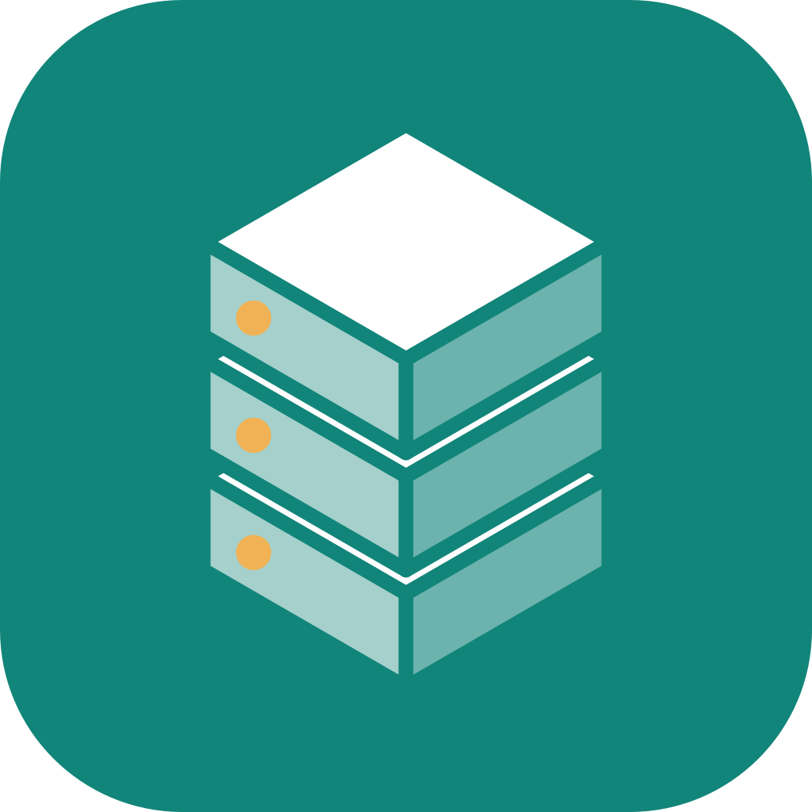
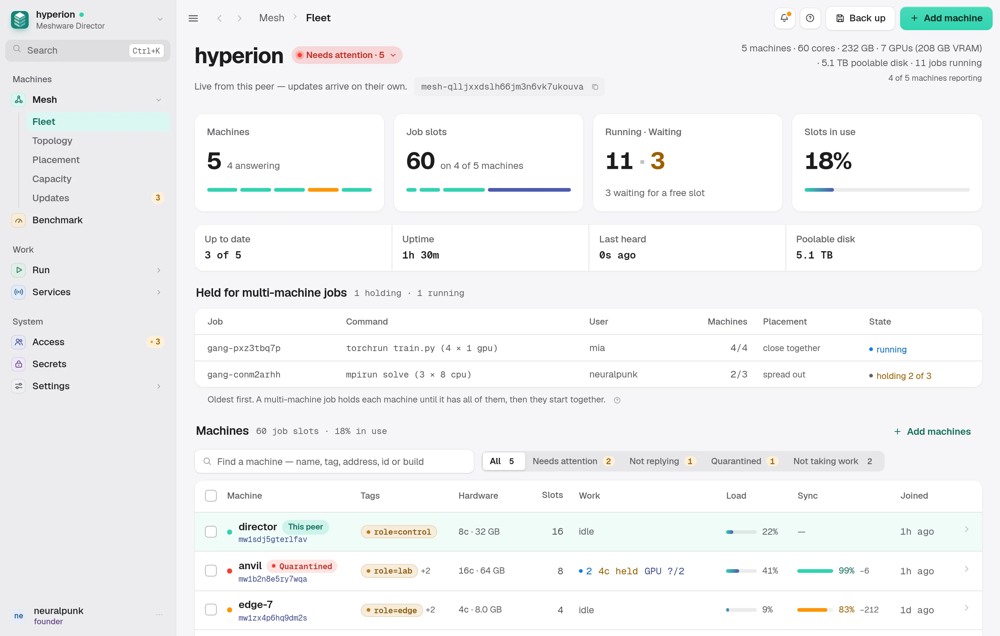
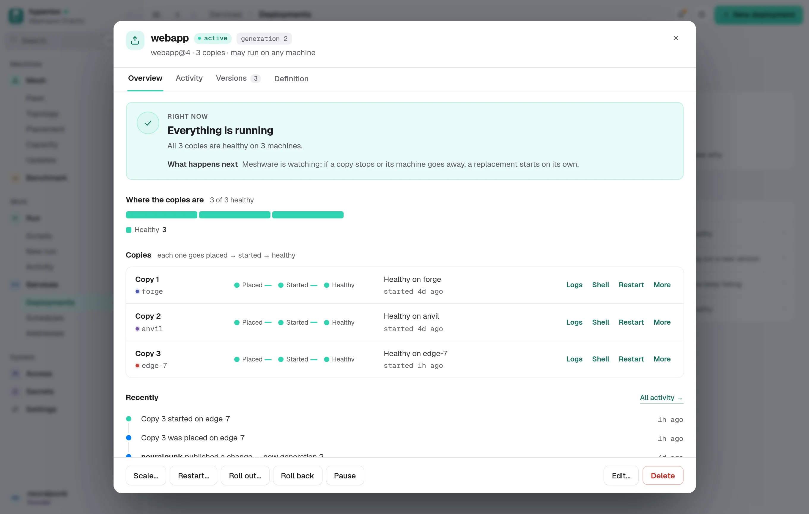
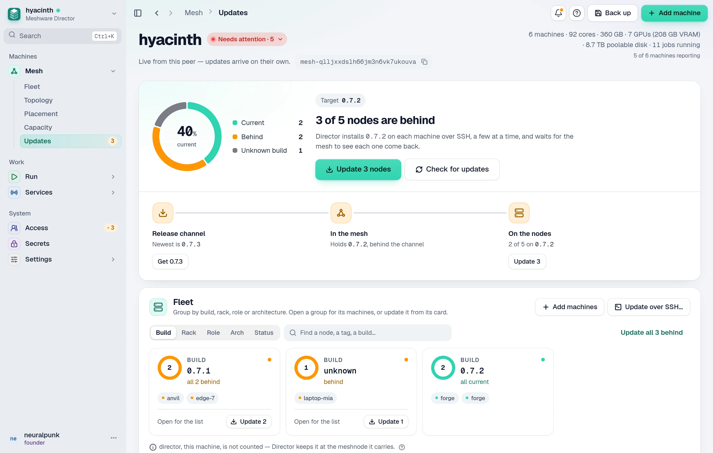

<p align="center">
  
</p>

<h1 align="center">Meshware</h1>

<p align="center">
  <strong>Your Linux machines, working as one.</strong>
</p>

<p align="center">
  <a href="LICENSE-MIT"></a>
  <a href="https://github.com/neuralpunk/meshware/releases"></a>
  
</p>

<p align="center">
  <a href="https://neuralpunk.github.io/meshware/">Website</a> ·
  <a href="https://neuralpunk.github.io/meshware/guide.html">User Guide</a> ·
  <a href="docs/quickstart.md">Quickstart</a> ·
  <a href="docs/director.md">Director</a> ·
  <a href="CHANGELOG.md">Changelog</a>
</p>

---

Meshware joins any number of Linux machines into a single peer-to-peer compute mesh. Install one
binary per machine, pair them, and schedule work across every CPU, GPU and gigabyte of memory:
run a command on every node at once, keep services running across them, or spread thousands of
tasks over whatever capacity is free — with no control plane, no database and no single point of
failure.

- **One binary, and every machine is equal.** `meshnode` is both the node and the command line.
  There is no control plane, no database and no quorum: nothing to stand up before you start,
  and nothing to keep alive after.
- **Secure with nothing to set up.** Every machine and every person is a key. A machine joins by
  pairing with a six-digit code, or with a single-use invite; every connection is encrypted;
  every job is confined to its own directory. Nobody generates a certificate.
- **A desktop app when you want one.** Meshware Director shows the whole mesh live and does
  everything the command line does, on the Linux desktop.
- **Free and open source,** under MIT or Apache 2.0 — no plans, no tiers, no machine limits, no
  account, no telemetry.

| Measured | |
|---|---|
| Servers that run no work | **0** |
| 400 items across two 16-core machines | **2.8 s** — and 6.8 s with one worker frozen mid-run |
| A machine that drops off the network | noticed in **5–10 s**, back **51 ms** after it returns |
| Largest mesh tested | **1,000 nodes**, simulated before every release |

<p align="center">
  
</p>

## Try it in one minute

No second machine needed — a real mesh of three nodes on the one you are sitting at, on
loopback only, gone when you stop it:

```console
$ git clone https://github.com/neuralpunk/meshware && cd meshware
$ make demo
```

`make demo` builds `meshnode` the first time (a few minutes) and then runs `meshnode demo`. Once
you have the binary, `meshnode demo` on its own does the same.

## Install

**From a release.** Download the tarball for your architecture from
[Releases](https://github.com/neuralpunk/meshware/releases), check where it came from, and
install the binary:

```console
$ gh attestation verify meshnode-v1.1.0-x86_64-unknown-linux-musl.tar.gz --repo neuralpunk/meshware
$ tar xzf meshnode-v1.1.0-x86_64-unknown-linux-musl.tar.gz
$ sudo install -m755 meshnode /usr/local/bin/
```

It is one static binary: no runtime dependencies, and the Linux distribution does not matter.
There are `.deb` and `.rpm` packages too, and a one-line installer:

```console
$ curl -fsSL https://raw.githubusercontent.com/neuralpunk/meshware/main/packaging/install.sh | sh
```

**From source.** Linux, [Rust](https://rustup.rs) and a C compiler:

```console
$ make doctor          # what this machine has, and what each build needs
$ make                 # meshnode and meshware-archive
$ sudo make install    # binaries, man pages, bash/zsh/fish completions
$ make director        # Director, the desktop app (needs Node.js and WebKitGTK)
```

`make help` lists everything. The full story — packages, `meshnode adopt`, running it as a
service — is in [installing a node](docs/operating/install.md), and
[the quickstart](docs/quickstart.md) goes from download to a two-machine mesh in about ten
minutes.

## A tour

Found a mesh, then add machines — by pairing on the same network, or by adopting the ones you
already reach over SSH:

```console
$ meshnode up                        # first run: identity + mesh genesis, fully encrypted listener
$ meshnode status

# on a second machine on the same LAN:
$ meshnode pair                      # announces itself, waits for approval
# …and on any member (or in Director):
$ meshnode pair                      # already in a mesh? the same verb approves instead
                                     # both screens show the same code → confirm → joined

$ meshnode adopt ops@rack-{1..10}    # install, service, pair, start — after this SSH is never needed again
```

Run things — on any machine, on every machine, or one item per free core across the mesh:

```console
$ meshnode run 'uname -a' --on any                   # run anywhere, streamed live
$ meshnode run 'apt list --upgradable' --fanout all  # every node, one multiplexed output
$ meshnode parallel -a hosts.txt -- ./check.sh {}    # GNU-parallel syntax, spread across the mesh
$ meshnode map -a logs.txt 'gzip -dc {} | grep -c ERROR'   # output stays on the node that made it
```

Nothing computes a split: every node pulls the next chunk when it finishes one, so a 32-core box
does about twice the work of a 16-core one. Freeze one mid-job and the rest re-run its share.

Work that has to start **together** — eight nodes, four cores each, or don't start — and GPUs as
real, assigned devices rather than a tag with a number in it:

```console
$ meshnode run ./train.sh --gang 8 --cpus 4                # MESHWARE_GANG_RANK & co. for torchrun
$ meshnode run ./train.sh --gpus 2 --vram-mb 24000         # a filter, not a preference
$ meshnode nodes --devices                                 # every card in the mesh, from any node
```

Don't do the same work twice, anywhere in the mesh — and spread a C build across it:

```console
$ meshnode run ./build.sh --cacheable --cache-outputs 'out/*'   # second time, on any node: instant
$ meshnode cc --verbose gcc -c src/parser.c -o parser.o         # distributed, cached compiles
```

Keep services running, with containers, ports, health checks, canaries and rollback — see
[deployments](docs/deployments.md). And live with it day to day:

```console
$ meshnode jobs explain job-7k1x8q                         # why did my job land there?
$ meshnode drain --until 06:00 --reason "kernel update"    # pause a machine, politely
$ meshnode doctor                                          # connectivity, clock, disk, ports, sandbox
$ meshnode backup                                          # one restorable file: identity + mesh state
```

Upgrades travel through the mesh itself — no release server, nothing to `scp` — and every node
checks the signature before it installs anything:

```console
$ meshnode upgrade --publish ./meshnode --version 1.1.0    # signed with your release key
$ meshnode upgrade --on tag=canary --to 1.1.0              # a few boxes first, then the rest
```

## Director

**Meshware Director** is the desktop app. It does everything `meshnode` does, laid out as
**Mesh** (Fleet, Topology, Placement, Capacity, Updates), **Run** (Scripts, New run, Activity),
**Services** (Deployments, Schedules, Addresses) and **System** (Access, Secrets, Settings) —
including the two jobs that used to need a terminal: adding machines over SSH, and updating them.

<p align="center">
  
  
</p>

Each release carries Director as a `.deb` and an `.rpm` for x86_64, with that release's `meshnode`
inside. [The Director guide](docs/director.md) walks through every screen; `make director`
builds it from source.

## What it costs to operate

| | Kubernetes | Nomad | Slurm | **Meshware** |
|---|---|---|---|---|
| Servers that run no work | 3–5 | 3–5 | 2 + a database daemon | **0** |
| External database | etcd | — | MySQL | **none** |
| Quorum to maintain | yes | yes | no | **none** |
| Upgrade procedure | ordered, documented, careful | ordered | ordered | **replace the binary** |

Every other getting-started guide begins *"first, stand up the control plane."* This one begins
*"run this on any machine."* The comparison columns are each project's own documented minimum
topology; [operational cost](docs/operational-cost.md) has the sources and the measurements.

## Documentation

| | |
|---|---|
| **[User Guide](https://neuralpunk.github.io/meshware/guide.html)** | **Everything, start to finish, on one page** |
| [Quickstart](docs/quickstart.md) | From download to a two-machine mesh running your commands |
| [What Meshware is](docs/introduction.md) | The words you will meet, and how the pieces fit |
| [Running work](docs/guides/running-work.md) · [machines](docs/guides/machines.md) | Commands on one machine or many; adding, tagging, draining and removing machines |
| [Compiling](docs/guides/compiling.md) | `meshnode cc`: a build spread across the mesh, and never built twice |
| [People and access](docs/guides/people-and-access.md) · [secrets](docs/guides/secrets.md) | Letting people in with the right role, and keeping passwords out of scripts |
| [Deployments](docs/deployments.md) | Keeping a service running across machines |
| [Director](docs/director.md) | Every screen of the desktop app, and the command that does the same |
| [Operating](docs/operating/README.md) | Install, network, security, upgrade, backup, air-gap, troubleshooting, limits |
| [Reference](docs/reference/README.md) | Every config key, environment variable, metric and file format, held to the code by CI |
| [No control plane](docs/no-control-plane.md) | How it works with nothing in charge — and what it deliberately does not promise |

## Security

Meshware runs commands on machines, so [SECURITY.md](SECURITY.md) is longer than most: what the
trust model claims, what a compromised node can and cannot do, and what is deliberately not
promised. Each job is confined to its own directory by Landlock and held to its CPU and memory
by its own cgroup, but there is no seccomp filter and no per-job user: Meshware is built for
trusted administrator automation and semi-trusted team workloads, not arbitrary untrusted code.

**There is no project-wide signing key.** Your mesh installs only binaries that one of *its own*
admins has signed, so nobody outside your mesh — Meshware's maintainers included — can push a
binary onto it. Releases carry GitHub build-provenance attestations, checkable with
`gh attestation verify`, and a CycloneDX SBOM.

Report a vulnerability through
[GitHub private vulnerability reporting](https://github.com/neuralpunk/meshware/security/advisories/new),
never a public issue.

## Meshware needs nothing from us

Meshware is built to keep working with no one upstream:

- **No accounts, no servers, no telemetry.** It makes no outbound connection you did not
  configure — no analytics, no licence check, no update ping. An air-gapped mesh is a supported
  configuration.
- **No keys held by anyone else.** Every mesh is its own release authority.
- **No lock-in.** It is open source under permissive licences, it builds from source with one
  `make`, and the documentation lives in the repository next to the code.

Updates arrive from time to time; between them, your mesh does not need us.

## Contributing

Bug reports, fixes and ideas are welcome — open an
[issue](https://github.com/neuralpunk/meshware/issues) or a pull request.
[CONTRIBUTING.md](CONTRIBUTING.md) covers building, testing without running a workstation out of
memory, and what CI checks; please read the [Code of Conduct](CODE_OF_CONDUCT.md) too.

## License

Meshware is free and open source, dual-licensed under either of

- [MIT License](LICENSE-MIT)
- [Apache License, Version 2.0](LICENSE-APACHE)

at your option. Use it for anything — personal, commercial, at any scale.

Unless you explicitly state otherwise, any contribution intentionally submitted for inclusion in
Meshware by you, as defined in the Apache-2.0 license, shall be dual licensed as above, without
any additional terms or conditions.
