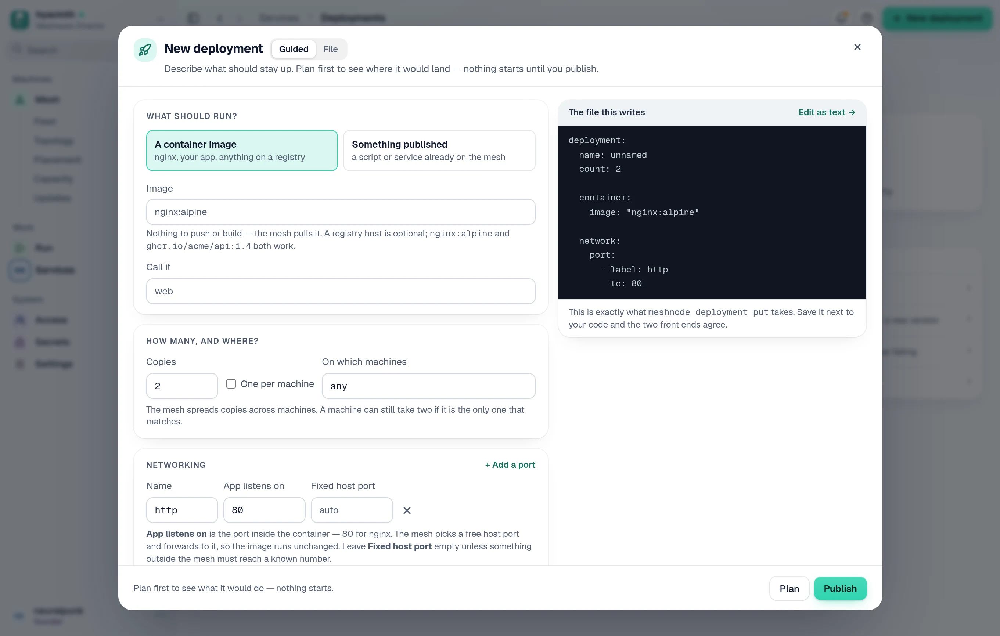
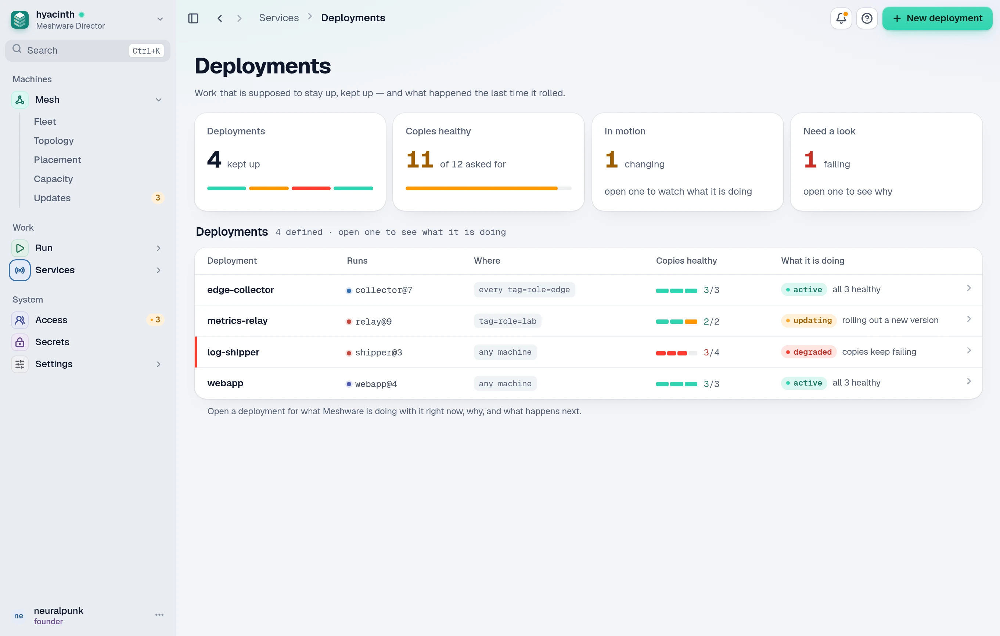
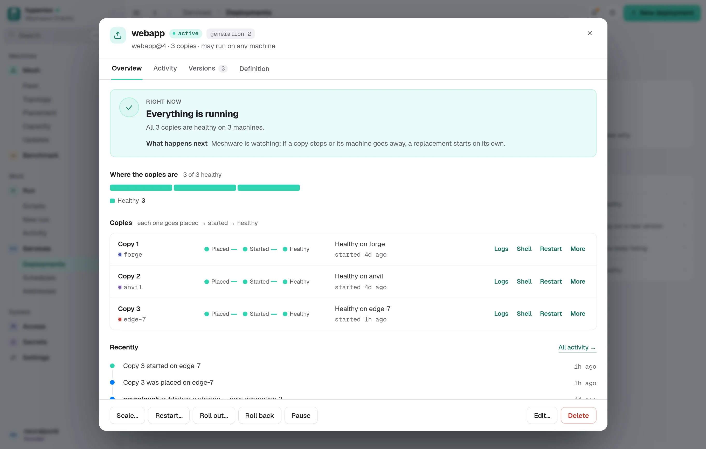
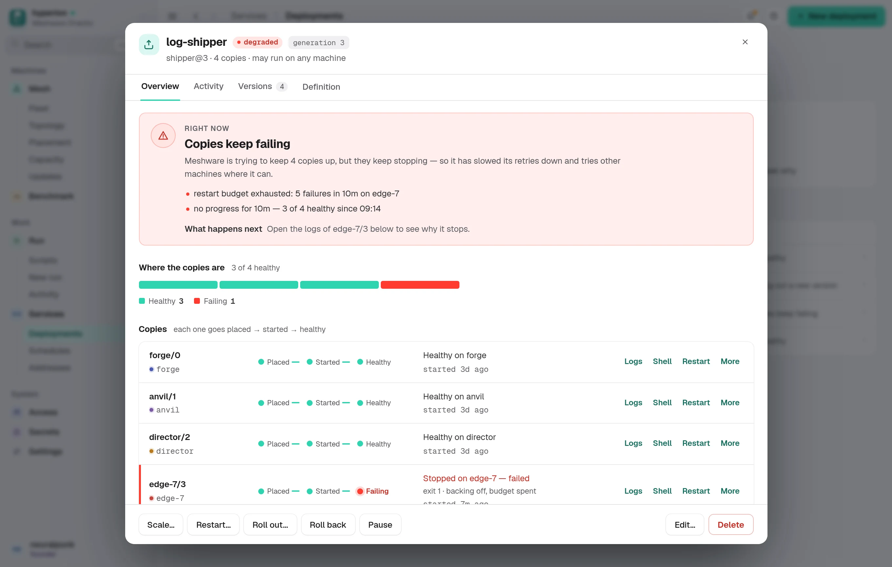
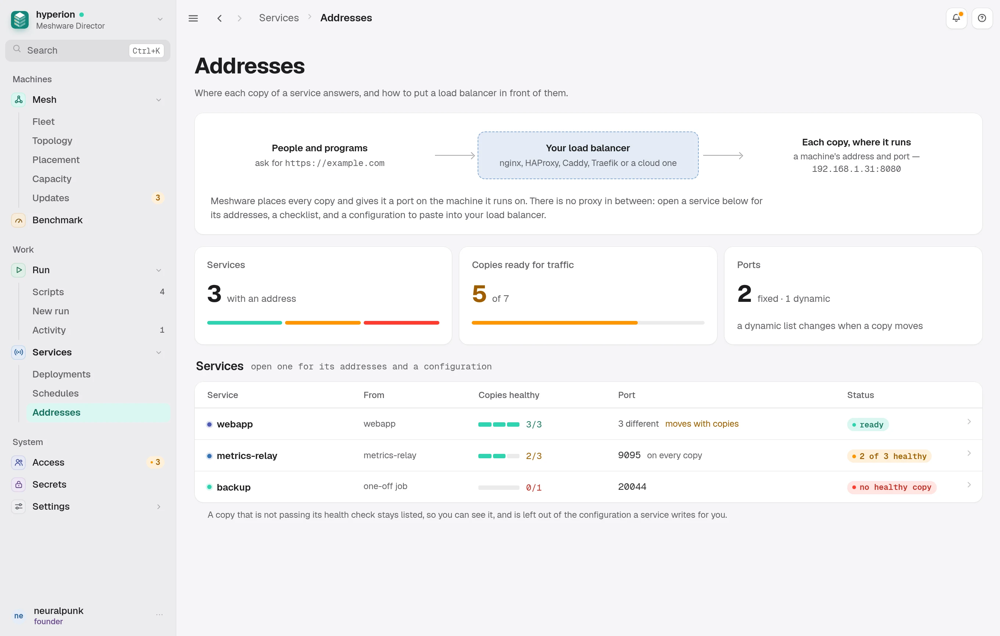
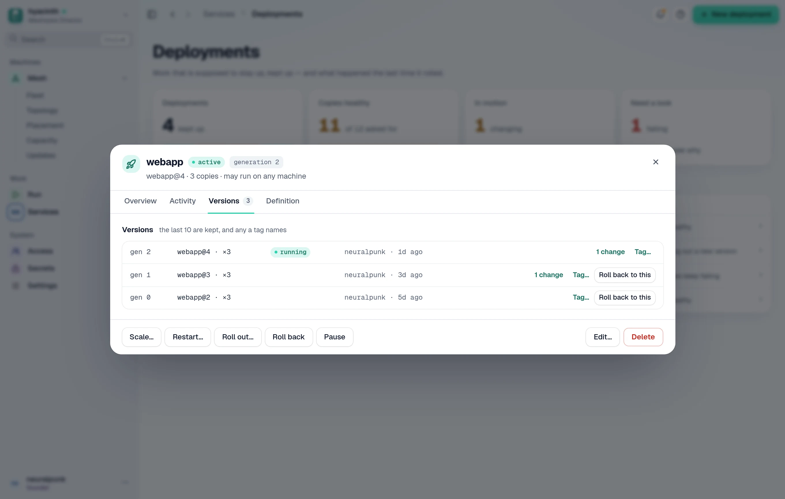
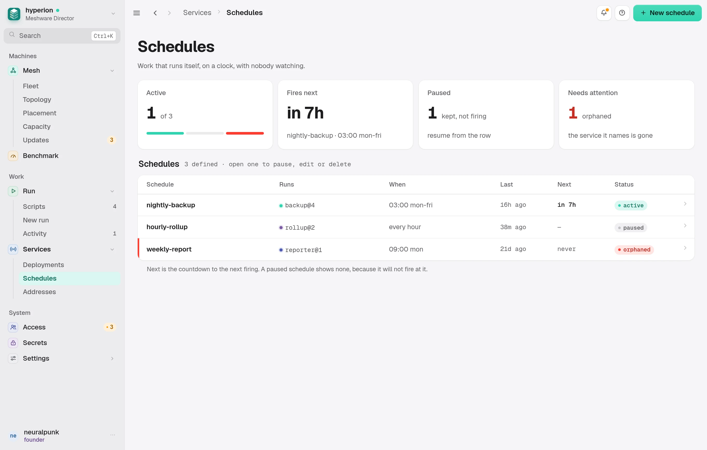

# Deployments

**A deployment is work that is supposed to stay up** — a website, an API, a queue worker, one
collector on every machine. You say what should run and how many copies; the mesh keeps it that
way. It restarts copies that die, replaces copies whose machine goes away, and rolls out changes a
few copies at a time, checking each new copy's health before it touches the next.

There is no server to install for this and no scheduler to keep alive: every machine in the mesh
knows every deployment, and whichever machine is best placed looks after each one.

This page walks through a real deployment from start to finish. Every key a deployment file
accepts is in the [deployment file reference](reference/deployment-file.md).

> [!TIP]
> **If you know HashiCorp Nomad, you already know how to use this.** The file has the same shape —
> `count`, `port { to = 80 }`, canaries and auto-revert, health checks by port label,
> `count: system` for one copy per machine. What is missing is the servers.
> [How this differs from Nomad](#how-this-differs-from-nomad) has the map.

---

## Before you start: a machine that can run it

A deployment runs either a **container image** or a **published script or service**. For
containers, the machines need `podman` or `docker`:

```console
$ sudo dnf install podman        # or: sudo apt install podman
$ sudo systemctl restart meshnode
$ meshnode runtimes              # container should now say `ready`
```

Nothing else is configured. Every machine checks what it can run when it starts, and work is only
sent to machines that can run it. On a machine where `meshnode` runs as a system service, rootless
containers need one more thing the installer normally does for you; if `meshnode runtimes` says
`broken`, it prints the fix, and [Runtimes](operating/runtimes.md) explains each case.

In Director, the same check is **Mesh › Capacity**, under *Runtimes*.

## 1. A web server on two machines

The thing everybody tries first, with nothing pushed and nothing built.

### In Director

Go to **Services › Deployments** and press **New deployment**, top right. A guided form opens on the
left, and the deployment file it writes appears on the right as you type.



1. **What should run?** — *A container image*: `nginx:alpine`. A registry host is optional;
   `ghcr.io/acme/api:1.4` works the same way. Nothing is pushed or built: each machine pulls it.
2. **Call it** `web`.
3. **Copies**: 2. The mesh prefers machines that do not already have a copy, so two copies land on
   two machines whenever two can take one. **One per machine** runs exactly one on every matching
   machine instead.
4. **Networking**: a port named `http`, and **App listens on** `80` — the port *inside* the
   container. Leave **Fixed host port** empty: each machine picks a free port and forwards it to
   80, so the image runs unchanged.
5. **Reachable as** `web` lists the copies as `web.mesh`.
6. **How do we know it is alive?** — *An HTTP request* to `/`. Without a check, a copy counts as
   alive while its process runs, even if it answers every request with an error.
7. **Plan** tells you where it would run, or why nothing can take it, and starts nothing.
   **Publish** starts it.

**File**, beside the title, swaps the form for the raw file — paste one in if you already have it.
The file on the right is exactly what the command line takes, so you can copy it into version
control and never open the form again.

### As a file

The same deployment, written by hand:

```yaml
# web.yaml
deployment:
  name: web
  count: 2

  container:
    image: docker.io/library/nginx:alpine

  network:
    port:
      - label: http
        to: 80          # the port inside the container

  resources:
    cpus: 1
    memory_mb: 128

  register:
    name: web           # answers at web.mesh

  health:
    kind: http
    port: http          # by label, so it follows whichever port the copy was given
    path: /
    interval: 10s
    grace: 10s

  update:
    canary: 1
    auto_revert: true
    min_healthy_time: 30s
```

Check it, ask the mesh what would happen, then publish it:

```console
$ meshnode deployment validate web.yaml     # the file alone, no mesh needed — fits in CI
$ meshnode deployment put --dry-run web.yaml   # where it would run, starting nothing
$ meshnode deployment put web.yaml

SLOT   NODE    GEN  STATE     HEALTH     JOB
0      web-1   0    running   healthy    job-7u4z3pboiw
1      web-2   0    running   healthy    job-acemnfdfiq

  2 desired · 2 placed · 2 healthy · 0 unhealthy · 5s

✓ rollout complete — 2/2 healthy in 5s
```

`put` follows the rollout until it settles; `--detach` returns at once. YAML, TOML and JSON all
work, with the same keys.

> [!TIP]
> **Start from a file that works.** `meshnode deployment init --name web --image
> docker.io/library/nginx:alpine > web.yaml` prints a commented file with every block a first
> deployment usually wants. `meshnode deployment schema > deployment.schema.json` gives your editor
> autocomplete — see [the reference](reference/deployment-file.md#autocomplete-in-your-editor).

## 2. Watching it roll

**Services › Deployments** lists everything that is supposed to stay up. The tiles across the top
answer for the whole mesh: how many deployments, how many copies healthy of how many wanted, how
many are changing, how many need a look.



Each row says what the deployment runs, where it may run, how many copies are healthy of how many
were asked for, and what it is doing in a few words:

| Status | Means |
|---|---|
| **active** | Every copy is where it should be and healthy |
| **updating** | A change is rolling out |
| **degraded** | Copies keep failing. Meshware slows its retries instead of restarting them in a tight loop, and keeps trying |
| **paused** | Published, but left alone: nothing is started, stopped or replaced until it is resumed |

**Open a deployment** to see what Meshware is doing with it, why, and what happens next:



- **Right now** says what is happening in one sentence. When it needs you, the button is on the same
  card: *Promote* a canary that is waiting, *Resume* a pause, *Roll back* a change that is stuck.
- **Where the copies are** is one cell per copy: waiting for a machine, starting, healthy or failing.
- **Copies** follows each copy from *Placed* to *Started* to *Healthy*, with **Logs**, **Shell** and
  **Restart** on its row.
- **Activity** is everything that happened to it — who changed it, every copy placed, started or
  failed, and anything Meshware could not do. **Versions** keeps the last ten versions. **Definition**
  is the file.
- Along the bottom: **Scale…**, **Restart…**, **Roll out…**, **Roll back**, **Pause**, **Edit…**, and
  **Delete**, which asks first.

From a terminal:

```console
$ meshnode deployment ls
$ meshnode deployment status web             # desired vs running vs healthy, per copy, live
$ meshnode deployment logs web --slot 1      # one copy's output
$ meshnode deployment exec web --slot 0 --reason "check config"   # a shell inside a container copy
```

### When a copy will not start

It is retried, with a growing delay. Inside its restart budget (5 failures in 10 minutes by default)
it is retried where it is; past the budget it backs off — up to an hour between attempts — and
prefers a machine it has not already failed on. It never gives up: a copy you asked for and did not
get is worth still trying for, and **degraded** stays on the row while the failures continue, so a
flapping service is visible rather than silently abandoned.



### How a change rolls out

With the file above, a change starts **one new copy** beside the old ones (`canary: 1`). It has to
pass its health check and stay healthy for `min_healthy_time` before anything is replaced; then the
old copies are replaced a few at a time. If the new version never becomes healthy within the
progress deadline (10 minutes by default when `canary` or `auto_revert` is set), `auto_revert: true`
puts the previous working version back on its own.

By default a canary that proves itself is promoted automatically. To look at it first, set
`auto_promote: false`: the healthy canary then waits until you press **Promote** in Director or run
`meshnode deployment promote web`.

## 3. Reaching it

**A copy answers on the machine it runs on, at the port that machine gave it.** There is no proxy,
virtual address or ingress in between. To give it a name other people can use, put a load balancer
in front.

### To look at it

**Services › Addresses** lists every copy's machine address and port, and which copies are passing
their health checks:



```console
$ meshnode registry web
service:  web
resolves: 2 of 2 instance(s)

NODE             ADDRESS                LABEL      HEALTH     INSTANCE
forge            192.168.1.31:24112     http       passing    …
edge-7           192.168.1.40:20417     http       passing    …

$ curl http://192.168.1.31:24112/
```

Two things have to be true for that `curl` to work:

- **The port has to be open from wherever you are.** Each copy gets a free port from its machine's
  range — 20000–32000 unless that machine's `[network] dynamic_ports` says otherwise — and
  Meshware opens no firewall for it.
- **The program has to listen on the machine's address, not loopback.** A container with `to:` is
  published on every interface for you. A process should listen on `$MESHWARE_IP_<LABEL>` and
  `$MESHWARE_PORT_<LABEL>` (or `0.0.0.0`); one listening on `127.0.0.1` is reachable from its own
  machine and nowhere else.

### A name for other people: a load balancer

Open a service in **Services › Addresses** for a ready-to-paste nginx, HAProxy, Caddy or Traefik
configuration. There are two shapes, and the first is the one to start with:

| Shape | In the file | The load balancer points at |
|---|---|---|
| **A fixed port on every machine** | `static: 8080` with `count: system`, so every matching machine runs one copy on 8080 | Each machine's address, port 8080. The list changes when machines do, not when copies move |
| **Dynamic ports** | ports left to the machines | The `web.mesh` SRV records, which carry each healthy copy's address and port — for a load balancer that reads SRV |

```nginx
upstream web {
    server 192.168.1.31:8080;
    server 192.168.1.40:8080;
}
server {
    listen 80;
    server_name example.com;
    location / { proxy_pass http://web; }
}
```

**Give the load balancer its own health check.** `web.mesh` stops handing out a copy the moment its
check fails; a fixed list of machines does not know that unless it checks too.

### Names on a machine: `.mesh`

Every node answers `<name>.mesh` for the services registered in the mesh, on port 8600 on loopback.
A machine's resolver does not send `.mesh` there until it is told to, and one command does it:

```console
$ sudo meshnode dns install
wrote /etc/systemd/resolved.conf.d/meshware.conf
ran systemctl restart systemd-resolved
this machine now sends .mesh to 127.0.0.1:8600

$ dig +short web.mesh
192.168.1.31
192.168.1.40
```

`--dry-run` prints what it would write. Machines added with `meshnode adopt` or Director's *Add
machines* get this done for them. Only A, AAAA and SRV records are answered, only for copies passing
their checks, and anything that is not `.mesh` is refused rather than forwarded.

## 4. Changing it

**Edit the file, publish it again.** That is the whole workflow. In Director, open the deployment,
press **Edit…**, change the image to `nginx:1.27-alpine`, and press **Save and roll**. One new copy
starts, proves itself, and the rest follow.

Publishing an unchanged file does nothing, which is correct. What rolls and what does not:

| You change | What happens |
|---|---|
| The image, the service version, `targets`, `inputs`, the health check, a port, `register`, a volume, a resource limit, an environment variable, `count` to or from `system` | A new generation, rolled out under the `update` rules |
| `count` from one number to another | No new generation. Copies are added or retired; the ones that stay keep running |
| `description`, `paused`, anything in `update` or `disconnect` | Nothing restarts. These describe how the *next* change rolls |
| `distinct_hosts`, `distinct_property`, `affinity`, `spread`, `priority`, `migrate` | Nothing restarts. They decide where the *next* copy goes |

Some changes are commands rather than edits:

```console
$ meshnode deployment scale web 4            # count, without restarting the copies that stay
$ meshnode deployment restart web            # replace every copy, under the update rules
$ meshnode deployment restart web --slot 1   # …or just one
$ meshnode deployment pause web              # leave it alone until `resume`
$ meshnode deployment rollout web api@4      # move a published-service deployment to a new version
```

Each of these re-publishes the deployment for you. If you keep the file in version control, copy the
change into it too, or the next `put` of the old file undoes it.

### Going back

**Roll back** in the open deployment, or:

```console
$ meshnode deployment rollback web                    # one version back
$ meshnode deployment history web -p                  # the last ten versions, with what changed
$ meshnode deployment rollback web --generation 4     # everything as it was at generation 4
$ meshnode deployment tag web golden                  # keep this version past the last ten
$ meshnode deployment rollback web --tag golden
```

A rollback is an ordinary change: it goes through the same careful rollout as any other. In
Director, **Versions** in the open deployment lists the same versions, with **Roll back to this**
and **Tag…** on each.



## 5. When a machine goes away, or is drained

**A machine that stops answering** is not assumed dead at once: its copies may be fine and simply
cut off. After the mesh notices (5 to 10 seconds of silence), each copy waits `lost_after` — 60
seconds by default — and is then replaced on a machine that answers. So a replacement is starting
about a minute and ten seconds after a machine vanishes. When the machine comes back, that slot has
two copies and one is retired: by default the original keeps its place and the replacement stops
(`disconnect.reconcile` chooses otherwise). `count: system` copies keep waiting, because their
place is that machine.

**Draining a machine** moves its copies somewhere else first. A replacement starts, proves itself,
and only then does the copy on the drained machine stop — so a service whose copies were all on one
machine never has none.

| To | Run |
|---|---|
| Send nothing new to a machine, and leave what runs there | `meshnode nodes contribute web-7 --off` |
| Empty a machine and keep it up | `meshnode nodes drain web-7` — copies have an hour to move, then whatever is left stops. `--deadline 4h` or `--no-deadline` to change that, `--lift` to end it |
| Take a machine out for maintenance and bring it back on its own | `meshnode drain --until 06:00 --reason "kernel update"`, on that machine |
| Shut a machine down | `meshnode drain` on that machine |

In Director: **Mesh › Fleet**, select the machine, **Drain** or **Contributing**.

## 6. Something once, on a clock, or on every machine

A deployment is for things that should keep running. The other three shapes people reach for:

| You want | Use | In Director |
|---|---|---|
| **Run something once** (Nomad's *batch*) | `meshnode run './migrate.sh' --on tag=db` | Run › New run |
| **Run something on a clock** (Nomad's *periodic*) | A schedule — below | Services › Schedules |
| **One copy on every machine** (Nomad's *system*) | A deployment with `count: system` | Services › Deployments |

### Schedules

A schedule runs a published script or service on an interval or at a time of day, with nobody
watching. It fires one job each time, on whichever matching machine the mesh picks.

```toml
# nightly-backup.toml
[schedule]
name     = "nightly-backup"
service  = "backup@4"        # a published script or service; `backup` alone runs the newest
at       = "03:00"
days     = "mon-fri"
tz       = "+02:00"          # a fixed offset: schedules never move with daylight saving
targets  = "tag=db"
timeout  = "45m"
catch_up = "once"            # after downtime, fire one missed run — never a backlog
```

```console
$ meshnode schedule put --dry-run nightly-backup.toml   # when it would next fire, and where
$ meshnode schedule put nightly-backup.toml
$ meshnode schedule ls
$ meshnode schedule pause nightly-backup
```

The vocabulary is deliberately small: `every = "15m"` or `at = "03:00"` (with optional `days`), and
never a cron string. Schedules fire at most once a minute, and `catch_up` is `skip` (the default) or
`once` — a machine that was down for a weekend does not wake up and run 192 backups. `overlap =
"skip"` (the default) does not start a run while the previous one is still going.

**Services › Schedules** shows when each schedule last ran and when it runs next. A schedule whose
script has been removed is **orphaned**, in red.



## 7. Ports, volumes and resources

The three things a deployment asks a machine for:

- **Ports.** Each machine lends a range of ports and hands one to each copy when it starts; the copy
  finds its number in `$MESHWARE_PORT_<LABEL>`. A fixed port (`static:`) is only safe with one copy
  per machine (`count: system`, or `distinct_hosts: true`), and anything else is refused when you
  publish. `meshnode ports` or **Mesh › Capacity** shows what each machine lends and what holds
  each port.
- **Volumes.** A machine lends a named directory in its own `meshnode.toml`, and a deployment claims
  it by name. A claim is an exclusive lease — one writer excludes everything, readers share — so a
  deployment with data goes only to the machines that have that data. Nothing copies, backs up or
  synchronises a volume; it is one directory on one machine.

  ```toml
  # meshnode.toml, on each machine that has the data
  [[volume]]
  name = "data"
  path = "/srv/meshware/data"
  ```

- **Resources.** `cpus` and `memory_mb` are both a filter and a ceiling: a machine without them is
  not considered, and where the machine can enforce limits, the copy is held to them. Leaving them
  out says nothing, which is not the same as saying zero.

## 8. Choosing machines

Every machine carries **tags**. Some it works out for itself — `cap.cores`, `cap.mem_mb`, `cap.rt`
(what it can run), its GPUs — and some an admin assigns from anywhere:

```console
$ meshnode nodes tag web-7 --add role=edge --add rack=b
```

An assigned tag is recorded in the mesh, not in a file on that machine, so it survives the machine
being rebuilt. A deployment's `targets` selects on tags and facts:

```yaml
targets: any                                  # anywhere that can run it
targets: tag=edge                             # machines tagged edge
targets: tag=role=db                          # key=value tags work too
targets: tag=gpu, tag=canary                  # both
targets: name=anvil|name=edge-7               # either
targets: fact.kernel_release:version>=6.1     # a fact the machine reports, compared as a version
```

Beyond *which* machines may run a copy, a file can say how copies are **shared out**: never two on
one machine (`distinct_hosts`), at most one per rack (`distinct_property`), preferring SSD machines
(`affinity`), three quarters at home (`spread`). See [the reference](reference/deployment-file.md#which-machines-it-prefers-placement-rules).
**Mesh › Placement** draws every machine with the copies on it.

## 9. Why did it not run here

When nothing can take a copy, Meshware does not just say "pending". It counts every machine it
looked at, groups them by the reason each one was ruled out, and says which reasons will clear on
their own:

```console
$ meshnode deployment put --dry-run api.yaml
deployment:    api
targets:       tag=edge
matches now:   0 nodes

NOTHING CAN TAKE IT RIGHT NOW:
  - selector tag=edge excluded 4 of 6 nodes
  - 1 node cannot run container work — install podman or docker
    there, or target nodes that have one
  - 1 node is too small for this: needs 4 cpu, needs 8 GB
  - no node in this mesh can take it as written

the definition is valid; the mesh has nowhere to run it yet
```

That text is built by the same code that did the ruling-out, so it cannot drift from the decision.
The same reasons appear beside the waiting copy in `meshnode deployment status` and in Director.
When the only reasons are ones that clear on their own, it says *waiting for capacity* instead, so
you do not edit a file that was never wrong.

`meshnode doctor` checks the machine itself, and **Run › Activity** or
`meshnode jobs logs <job>` has the output of anything that started and failed.

## How this differs from Nomad

The same shapes, on purpose: the file's structure, `port { to = … }`, canary and auto-revert,
health checks by port label, `count: system`, resources as a filter and a ceiling,
`distinct_hosts`, affinity and spread, a drain that moves copies before it stops them, and a plan
before an apply.

| In Nomad | In Meshware | In Director |
|---|---|---|
| Job, `type = "service"` | Deployment | Services › Deployments |
| Job, `type = "batch"` | A run (`meshnode run`), or a schedule | Run › New run |
| Job, `type = "system"` | Deployment with `count: system` | Services › Deployments |
| Periodic job | Schedule | Services › Schedules |
| Task driver | Runtime, detected, never configured | Mesh › Capacity |
| `nomad node status -verbose` | `meshnode runtimes` | Mesh › Capacity |
| Consul service catalog | The built-in registry, `<name>.mesh` | Services › Addresses |
| Host volumes | Volumes, as exclusive leases | Mesh › Capacity |
| Constraints | Selectors on tags and facts | wherever you choose machines |
| Servers, Raft, `nomad server join` | — nothing — | |

**What is missing, and what that buys.** There are no servers: every machine is a peer. There is no
quorum: a machine cut off from the rest keeps running what it has, and rejoins when it can. There
is no Consul: every node holds the whole service catalogue and answers `.mesh` itself. And no
Vault is required: [secrets](operating/security.md#4-secrets) are part of the mesh.

**What that costs.** State converges rather than being agreed. Two admins changing the same thing
on both sides of a network split both succeed, and the later change wins when the halves meet —
the right trade for a fleet of machines, and the wrong one for a bank ledger.
[How Meshware works without a control plane](no-control-plane.md) sets out exactly what is and is
not promised, and [By design](reference/by-design.md) lists every deployment and schedule refusal
with the reason on each.
