# The Director guide

Director is Meshware's desktop app: every machine, every job and every person in your mesh, live,
on one screen — and every action the `meshnode` command line has, as a button.

It is not a dashboard pointed at a server, and it is not a server either. Director is a **view onto
this computer's node** — the same `meshnode` every other machine in the mesh runs — and it talks to
that node exactly the way the `meshnode` command line does. Close Director and nothing changes: the
node keeps running, the mesh does not notice, and `meshnode` in a terminal carries on where the
window left off. Everything Director does, `meshnode` can do from a terminal, and the other way
round; [Every action, both ways](#every-action-both-ways) at the end of this page lists them side by
side.

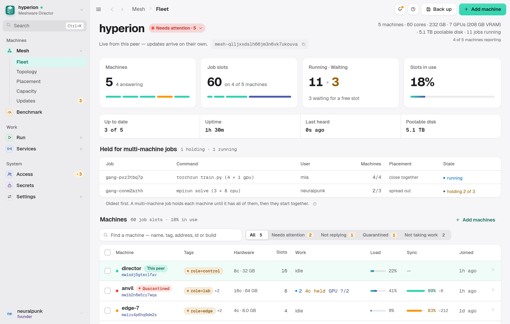

---

## Getting Director

Director runs on **Linux** desktops. It is a single binary with its interface built in.

Each release publishes Director as a `.deb` and an `.rpm` for x86_64 on the
[Releases page](https://github.com/neuralpunk/meshware/releases), carrying that release's
`meshnode` so Director can install this machine's node for you. Check the download against the
release's `SHA256SUMS`, then install it with your package manager:

```console
$ sha256sum -c SHA256SUMS --ignore-missing
$ sudo apt install ./meshware-director_<version>_x86_64.deb      # Debian, Ubuntu
$ sudo dnf install ./meshware-director-<version>.x86_64.rpm     # Fedora, RHEL
```

On another architecture, or to build it yourself, build Director from the source tree, on the
machine that will run it or on one like it:

```console
$ make doctor                     # says whether Node.js and WebKitGTK are installed
$ make director WITH_NODE=1       # about four minutes; carries a meshnode for this machine
$ sudo make install-director      # optional: /usr/local/bin/meshware-director
```

The build needs a Rust toolchain, Node.js 20+, and the WebKitGTK 4.1 development packages Tauri
builds against (`make doctor` names the package for your distribution). The finished binary is
`target/director/meshware-director`; copy it anywhere and run it, and it adds itself to your
application menu. `WITH_NODE=1` builds a static `meshnode` and carries it inside Director, as a
release does, so Director can install this machine's node for you. `make director-package` builds
the `.deb` and `.rpm` a release ships instead. Director signs
with your personal key in `~/.meshware/identity/user.key` — the same key the `meshnode` command
line uses on that machine, so the two are the same person — and keeps only its own window settings
in `~/.meshware/director`.

## Director and `meshnode` on the same computer

Every computer in a mesh runs one node, in `~/.meshware`. On a desktop it runs as your own systemd
service, `meshnode`: the first time Director needs it, Director installs it — the `meshnode` it
carries goes to `~/.local/bin/meshnode`, the service to `~/.config/systemd/user/` — and starts it.
It starts again at every login, and it does not stop when Director does.

So the command line works with no setup, whether Director is open or not:

```console
$ meshnode status          # the same node, the same mesh, the same you
$ meshnode run 'uname -a'
$ systemctl --user status meshnode
```

Without Director, `meshnode up --detach` installs and starts the same service, and `meshnode up`
runs the node in the foreground instead. Settings Director changes are the node's own: they are
written to `~/.meshware/meshnode.toml` or signed into the mesh, exactly as `meshnode` would, so
there is no second copy anywhere for the two to disagree about.

**Coming from an older Director**, which ran a node inside the app from `~/.meshware/director`:
the first start of this one — or the first `meshnode up` — moves that node into `~/.meshware`,
keeping its identity, its name and its history, so the machine stays the same member of the same
mesh. It will not do that while an older Director is still running; quit it first.

## The first run

The first time Director starts, it asks what you want to do:

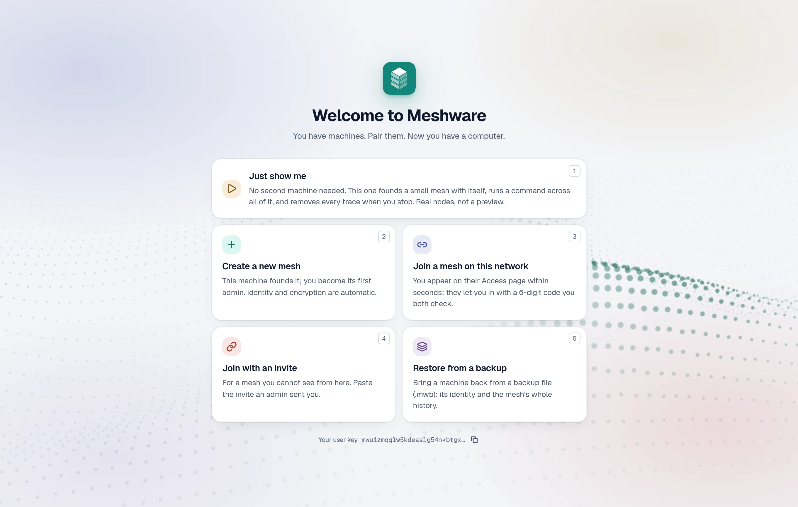

| Choice | Use it when |
|---|---|
| **Just show me** | You want to see it work without a second machine. Director starts a small, real mesh on this computer, runs a command across it, and removes every trace when you stop. |
| **Create a new mesh** | This is the first machine. It founds a new mesh and **you become its first administrator**. |
| **Join a mesh on this network** | A mesh already exists on your local network. Your machine appears on an admin's **Access** page within seconds; they let you in after you both check the same six-digit code. |
| **Join with an invite** | The mesh is somewhere you cannot see from here — another office, a cloud network. Paste the invite token an admin sent you (`meshnode invite create` makes one). |
| **Restore from a backup** | You are bringing a machine back from a backup file (`.mwb`): its identity and the mesh's whole history. |

When you join an existing mesh, Director also asks for the **name people will know you by**, and
sends the mesh a request to recognise you. An admin approves it — from **Access** in their own
Director, or with `meshnode users approve` — and chooses what you may do.

**Contribute compute** decides whether this computer runs work for the mesh. On a machine that
already runs `meshnode`, Director does not offer it: that machine's compute is already in the mesh,
so Director joins alongside it **as a user**, and the machine is not counted twice.

## Finding your way around

The sidebar on the left has three groups:

| Group | Sections | What you do there |
|---|---|---|
| **Machines** | **Mesh** — Fleet, Topology, Placement, Capacity, Updates | See your machines, add more, and keep them current |
| **Work** | **Run** — Scripts, New run, Activity · **Services** — Deployments, Schedules, Addresses | Run things once, keep things running, and find where they answer |
| **System** | **Access** · **Secrets** · **Settings** | Let people in, keep secrets, and look after this computer and the mesh |

A few things work the same everywhere:

- **Click a section to open or close it.** The rows under it are the screens.
- **The breadcrumb** at the top reads section, then screen — *Services › Deployments* — which is how
  this guide writes locations too.
- **A screen's main action is the button at the top right**: *New deployment*, *Add machines*,
  *Grant a role*.
- **Search** (the box at the top of the sidebar, or <kbd>Ctrl</kbd>+<kbd>K</kbd>) finds any screen or
  action by name — *Set a secret*, *Invite someone*, *Check for updates* — and shows the
  `meshnode` command that does the same.
- **The bell** at the top right lights up when something is waiting on you — usually a machine or
  a person asking to join — and takes you to it.
- **The ?** at the top right explains the screen you are on.

---

## Machines

### Mesh › Fleet

Every machine in the mesh: whether it is answering, its tags, its hardware, how many jobs it is
running, how loaded it is, and whether its copy of the mesh's state is up to date. The strip across
the top adds the whole mesh up — machines, cores, memory, GPUs, disk and running jobs.


- **Add machines** (top right) installs Meshware on machines you can reach over SSH — see
  [Adding machines](#adding-machines).
- **The filters** above the table — *Needs attention*, *Not replying*, *Quarantined*, *Not taking
  work* — narrow a big fleet to the machines worth looking at.
- **Select a machine** for its details, its addresses and its actions: **Ping** it, **Drain** it,
  decide whether it is **Contributing** work, **Quarantine** it, edit its **Tags**, open a
  **terminal** on it, or **Revoke** it for good. Tick several to act on them together.
- **Accelerators** lists every GPU in the mesh, what it is busy with and whether it is healthy.

### Mesh › Topology

The same machines drawn as a network: who can reach whom, and how loaded each machine is. Select a
machine for its details and its recent events. Useful when some machines cannot reach others.

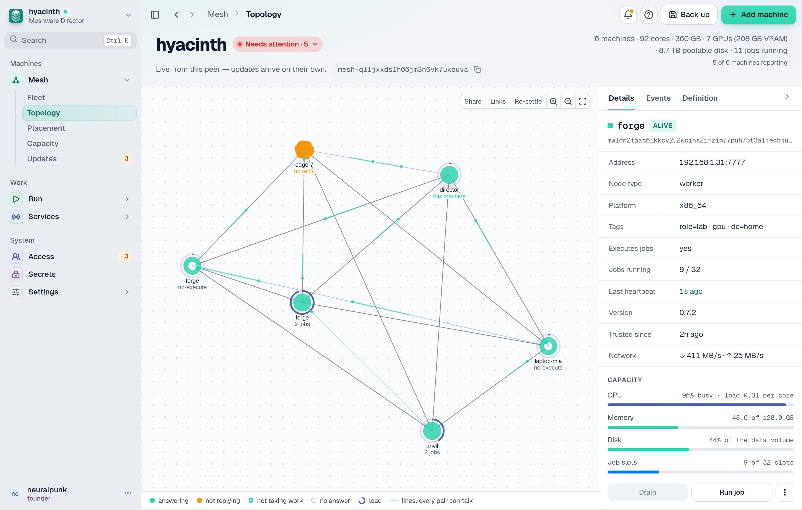

### Mesh › Placement

What runs where. Every machine is drawn with the deployment copies on it and how much of the
machine they asked for, so you can see at a glance whether a machine is full, draining, or held back
from new work.

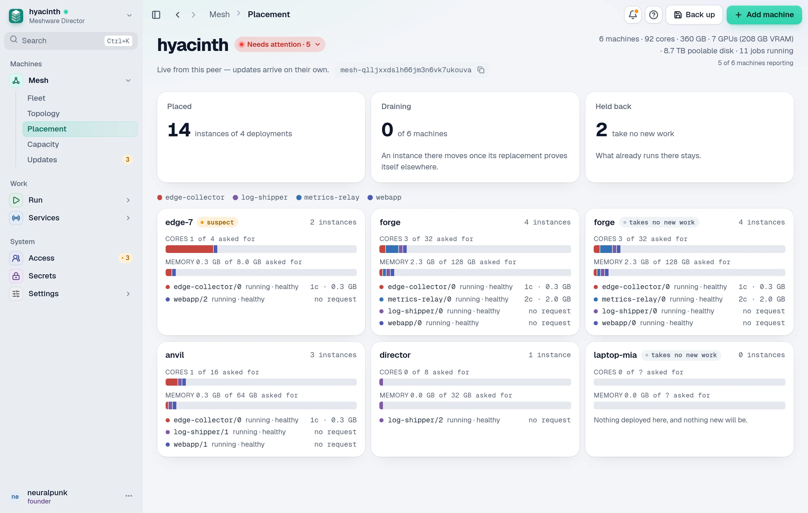

### Mesh › Capacity

The first place to look when work will not start. Four panels:

- **Compute** — how much machine the mesh adds up to, and which machines are lending it.
- **Runtimes** — what each machine can run: plain binaries, shell scripts, Python, Ansible,
  containers. Nothing here is configured; install a tool (for example `podman`) and the machine
  finds it the next time it starts. See [Runtimes](operating/runtimes.md).
- **Ports** — the port range each machine lends to services, and what holds each port now.
- **Volumes** — the directories each machine lends to deployments, who holds them, and
  *Provision a volume…*.

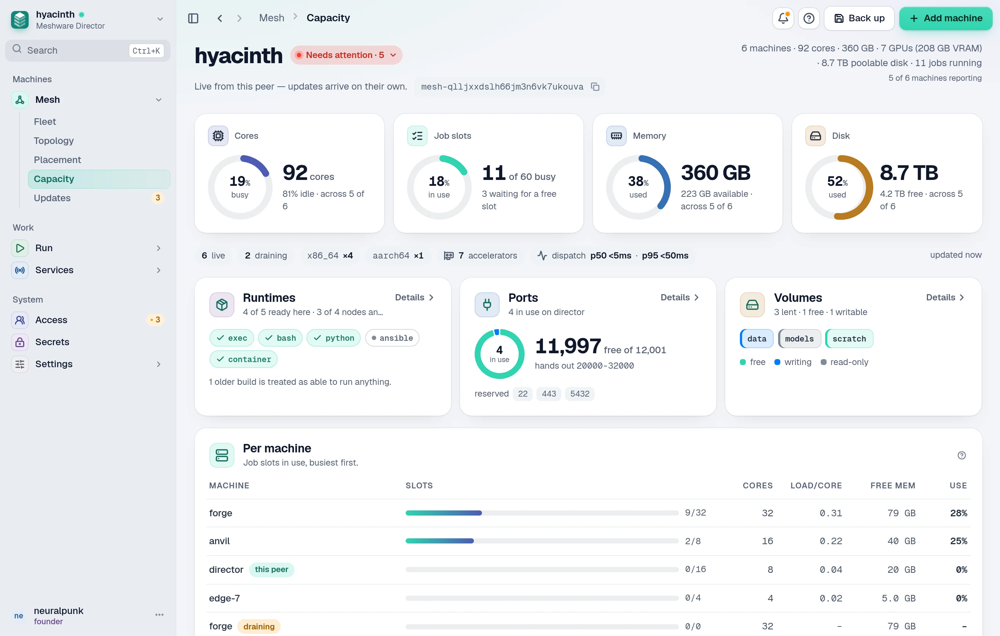

### Mesh › Updates

Is every machine running the current version, and what to do if not. The number beside *Updates*
in the sidebar is how many machines are behind.

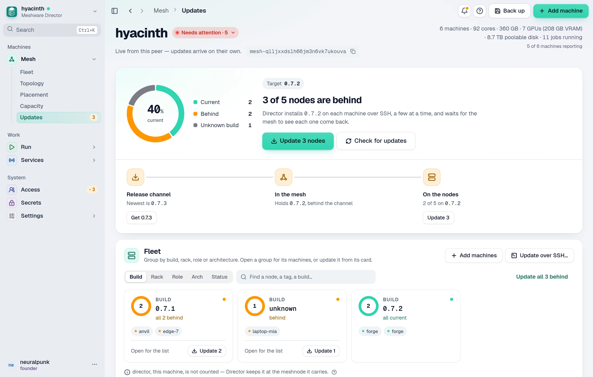

Read the three steps left to right and act on the one that is not ticked:

1. **Release channel** — **Check for updates** looks for a newer release on GitHub, and **Get**
   fetches it into the mesh: the download is checked against the release's `SHA256SUMS`, then
   signed with *your* release key (derived from your identity, and trusted mesh-wide the first
   time). There is no project-wide key; your mesh installs what its admins vouch for.
2. **In the mesh** — the release the mesh holds, ready to install.
3. **On the nodes** — **Update N nodes** installs it on each machine that is behind, over SSH, a
   few at a time, and waits for the mesh to see each machine come back before moving on. SSH is
   used because it works on every machine: the shipped service is not allowed to replace its own
   binary.

**Group by** build, rack, role or architecture to update one group at a time. Under **Advanced**,
fleets whose machines *are* allowed to replace their own binary (the opt-in fleet-upgrade drop-in,
see [Upgrading](operating/upgrade.md)) can roll out through the mesh instead, in health-checked
waves; you can also pick machines by hand, manage release keys, and publish a build of your own.

The same thing from a terminal is [`meshnode upgrade`](operating/upgrade.md).

### Adding machines

**Mesh › Fleet › Add machines** does what `meshnode adopt` does, without a terminal. Give it:

- **Machines** — one or more SSH targets. Ranges expand: `rack-{1..10}` is ten machines.
- **Credentials** — a user, and a password, a key file or your ssh-agent. A password is used for
  `sudo` too unless you say otherwise, is kept in memory for this run only, and can be remembered in
  your desktop's keychain for those machines.
- **Tags** (optional) to stamp on the new machines.

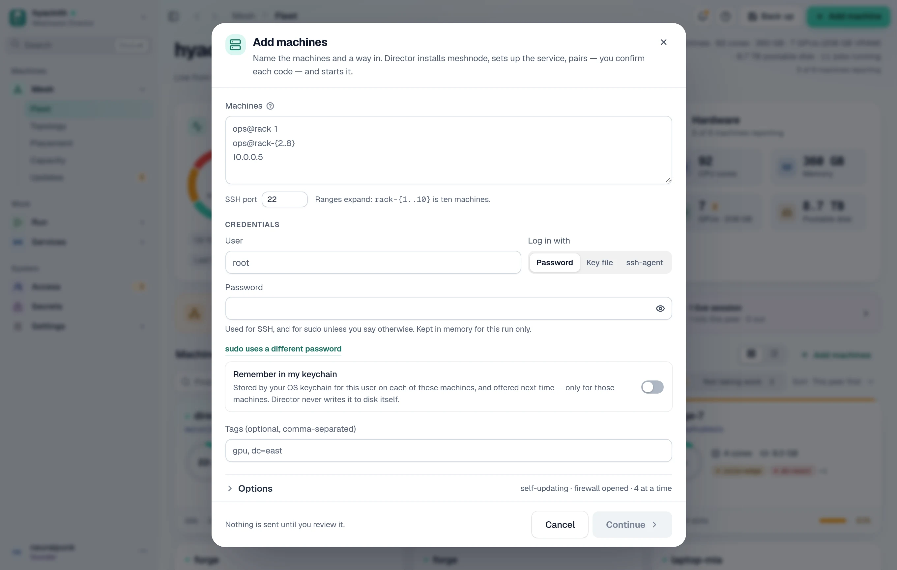

Nothing is sent until you review it. Director then installs `meshnode` on each machine, sets it up
as a service with its own account, opens the mesh port in the firewall, and pairs it — showing you
the confirmation code for each machine to check. **Confirm all** accepts every code at once.
Finally it waits until the mesh sees each machine alive.

A machine on the same network can also join on its own: start Director or `meshnode pair` there,
and it appears on the **Access** page, where you **Let in…**.

---

## Work: running things once

### Run › Scripts

What this mesh can run by name. A script is a file — a shell script, a Python program, an Ansible
playbook — that you add once and anybody allowed can then run anywhere, with its arguments filled
in by a form.

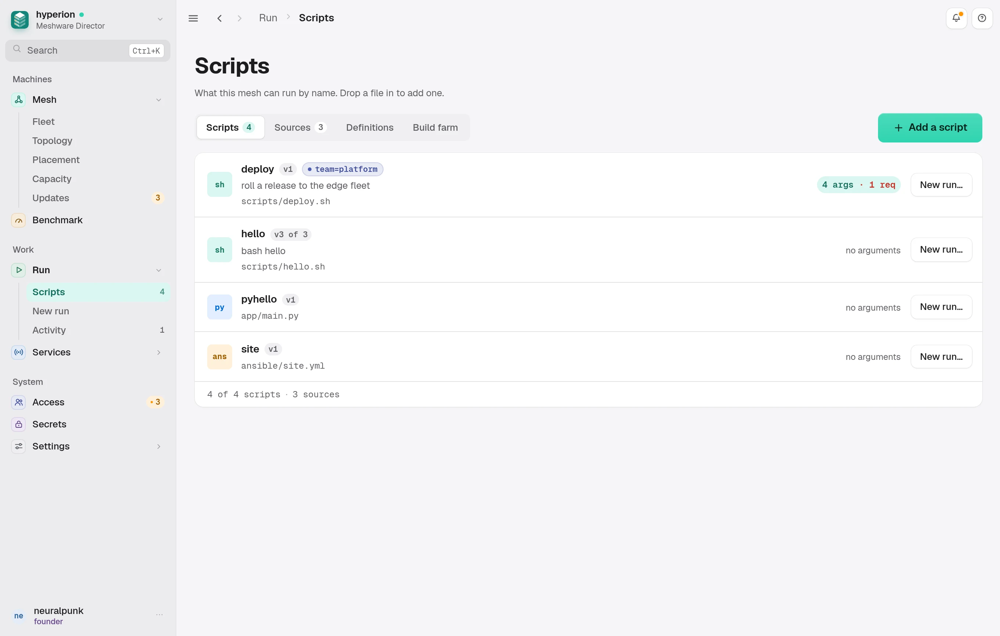

- **Add a script**, or **drop a file anywhere on this window**, to add one. Director reads the
  script's own header (or the flags it reads) to work out its arguments.
- **New run…** on a script opens New run with that script chosen.
- **Sources** keeps scripts in step with a Git repository.
- **Definitions** shows everything this mesh distributes, and how far each version has spread.
- **Build farm** is the setup panel for `meshnode cc`: what the mesh's result cache is saving, and
  the exact line to paste into a build so each file compiles on whichever machine has room.
  [Compiling across the mesh](guides/compiling.md).

From a terminal: `meshnode add ./backup.sh`, and `meshnode script inspect ./backup.sh` to see what
it would register.

### Run › New run

Run one thing: a saved script or a one-off command, on the machine you choose — or let the mesh
pick one with room.

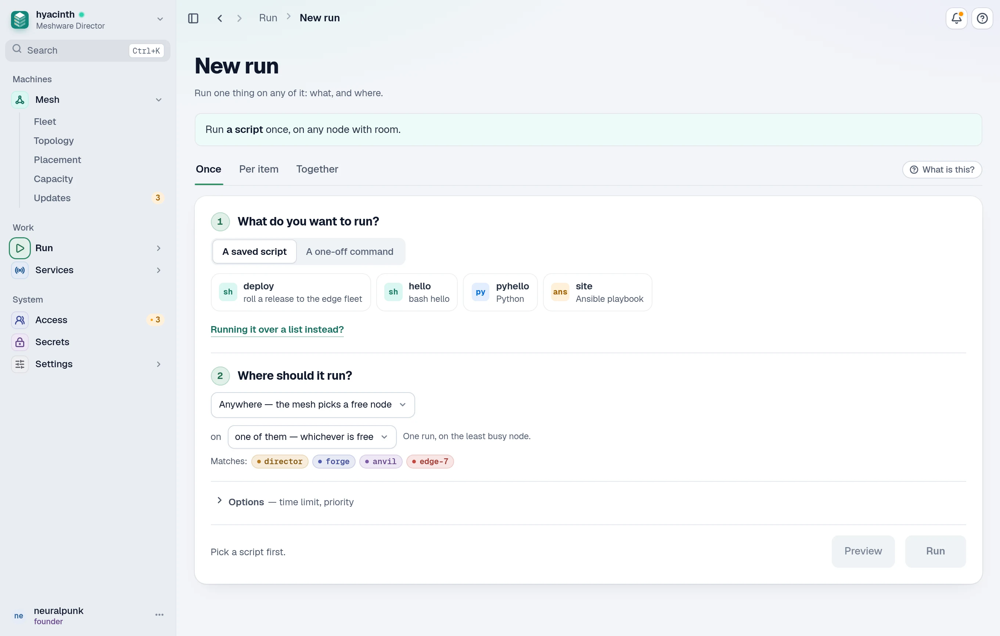

1. **Once**, **Per item** or **Together**: once on one machine (or every machine), once per line of
   a list, or on several machines that must start at the same moment.
2. **What do you want to run?** A saved script, or a one-off command.
3. **Where should it run?** Anywhere, a tag, a named machine, or a selector. *One of them* runs it
   once on whichever is free; *all of them* runs it on every match.
4. **Options** sets a time limit and a priority. **Preview** shows what would happen without
   starting anything; **Run** starts it and streams the output back live.

The same thing is `meshnode run` — for example `meshnode run 'uname -a' --on tag=edge --fanout all`.

### Run › Activity

What ran, what it answered, and what is waiting to be collected. Filter by state, open any job for
its full output, and cancel one that is still running.

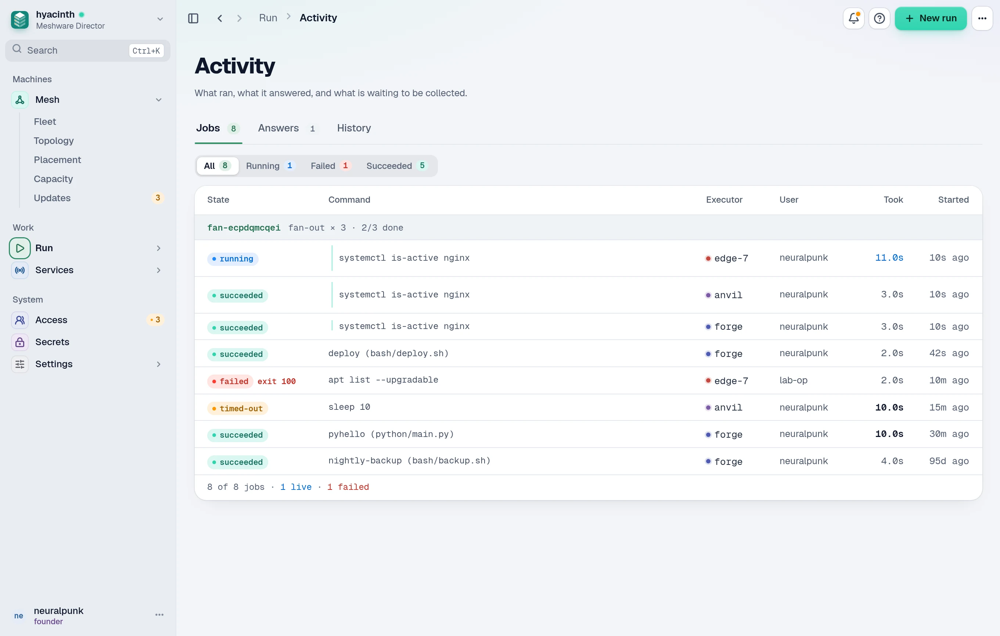

- **Jobs** is everything recent; a fan-out is one row you can expand into a row per machine.
- **Answers** collects the structured results of runs that were asked to gather them.
- **History** searches older jobs, including ones kept in the long-term archive.

From a terminal: `meshnode jobs`, `meshnode jobs logs <job>`, `meshnode jobs cancel <job>`.

---

## Work: keeping things running

These three screens have [a guide of their own](deployments.md). In short:

### Services › Deployments

Work that is supposed to **stay up**: a web server, an API, a collector on every machine. You say
what should run and how many copies; the mesh keeps it that way — restarting copies that die,
replacing copies whose machine goes away, and rolling out changes a few copies at a time, checking
each one's health before moving on.

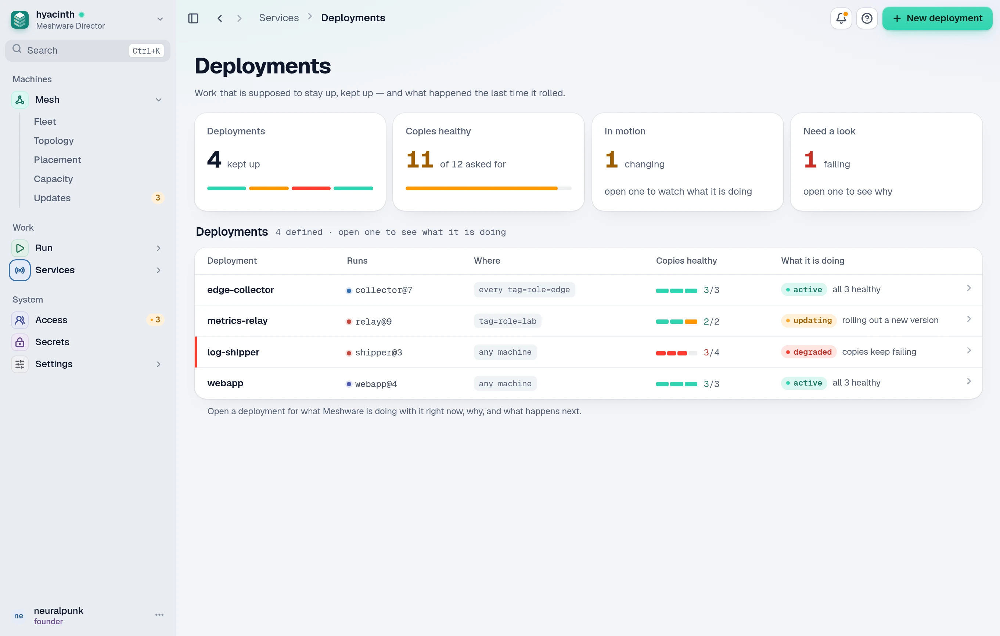

**New deployment** opens a guided form that writes the deployment file as you type. **Plan** says
where it would run without starting anything; **Publish** starts it. Open any deployment to watch
what it is doing, and to **Scale**, **Restart**, **Roll out**, **Roll back**, **Pause** or **Edit** it.

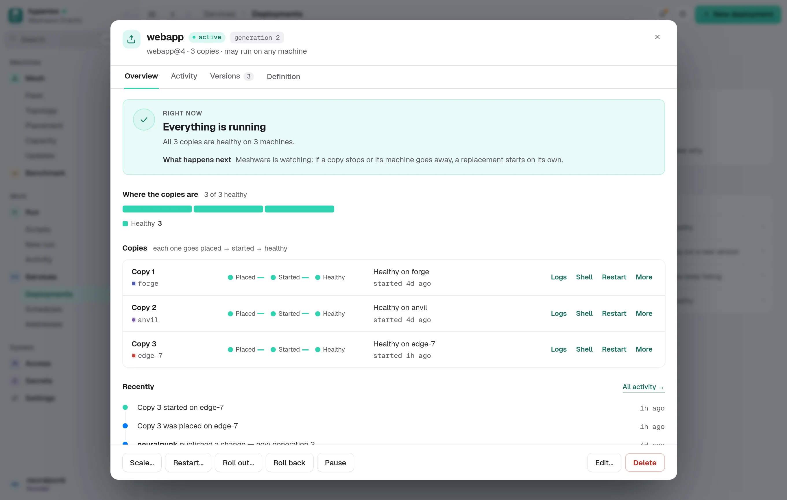

### Services › Schedules

Work that **runs itself on a clock**: a backup every night, a report every Monday. The list leads
with when each schedule last ran and when it runs next. A schedule whose script has been removed is
marked **orphaned**, in red, so a schedule that quietly stopped doing anything cannot go unnoticed.

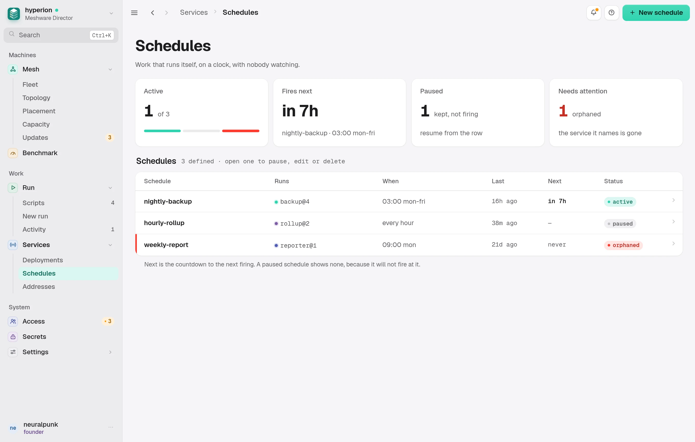

### Services › Addresses

Where each copy of a service answers: the machine's address and the port it was given. Open a
service for every copy's address, a checklist, and a ready-to-paste configuration for nginx,
HAProxy, Caddy or Traefik to put in front of them.

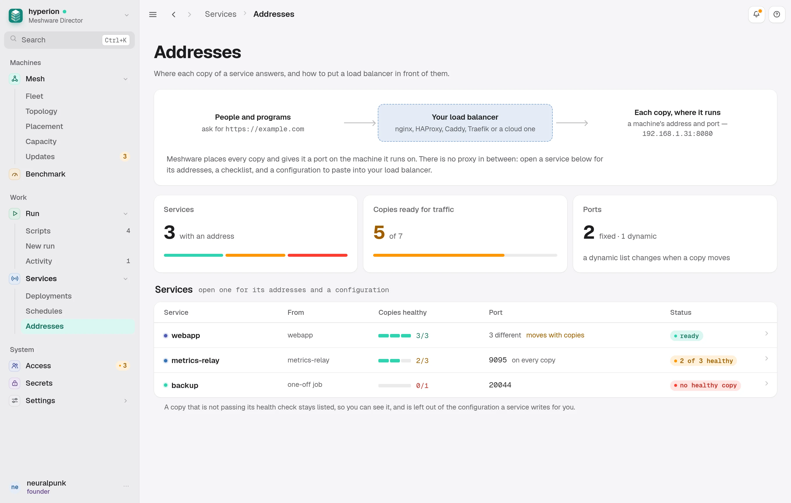

---

## System

### Access

Who is in the mesh, and what each person may do. This is where you let machines and people in,
give them roles, and take access away.

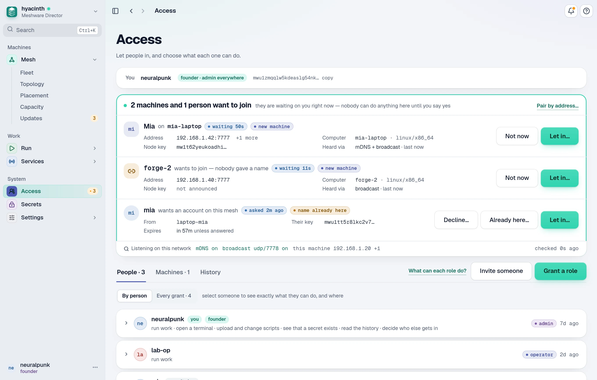

**Someone waiting to join** appears at the top, with what is known about them: a new machine asking
to be let into the mesh, or a person asking for an account. For a machine, **Let in…** shows the
confirmation code — check it matches the one on the other machine's screen. For a person,
**Let in…** asks what role to give them. **Not now** or **Decline…** turns them away.

**People** lists everyone with an account and, in plain words, what each of them can do. Select a
person to see exactly where their access applies, add a grant, or replace their key if it was lost.

**Grant a role** gives someone a role, and asks where (the whole mesh, some machines by tag, or one
machine) and for how long (until revoked, or for a fixed time). The panel shows, before you save,
what the person will and will not be able to do. Grants add up: a second grant joins whatever the
person already has.

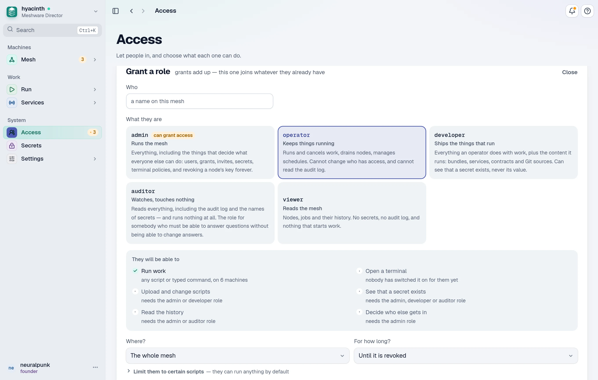

**What can each role do?** compares the five roles side by side:

| Role | In short |
|---|---|
| **admin** | Runs the mesh: everything, including deciding who else gets in |
| **operator** | Keeps things running: runs and cancels work, drains machines |
| **developer** | Ships the things that run: everything an operator does, plus scripts, services and Git sources |
| **auditor** | Watches and touches nothing: reads everything, including the audit log, and runs nothing |
| **viewer** | Reads the mesh: machines, jobs and their history; no secrets, no audit log |

**Invite someone** makes an invite for a machine that is not on your network. An invite lets a
machine join; it does not decide what the person on it may do — they still appear at the top of
Access for you to name and give a role.

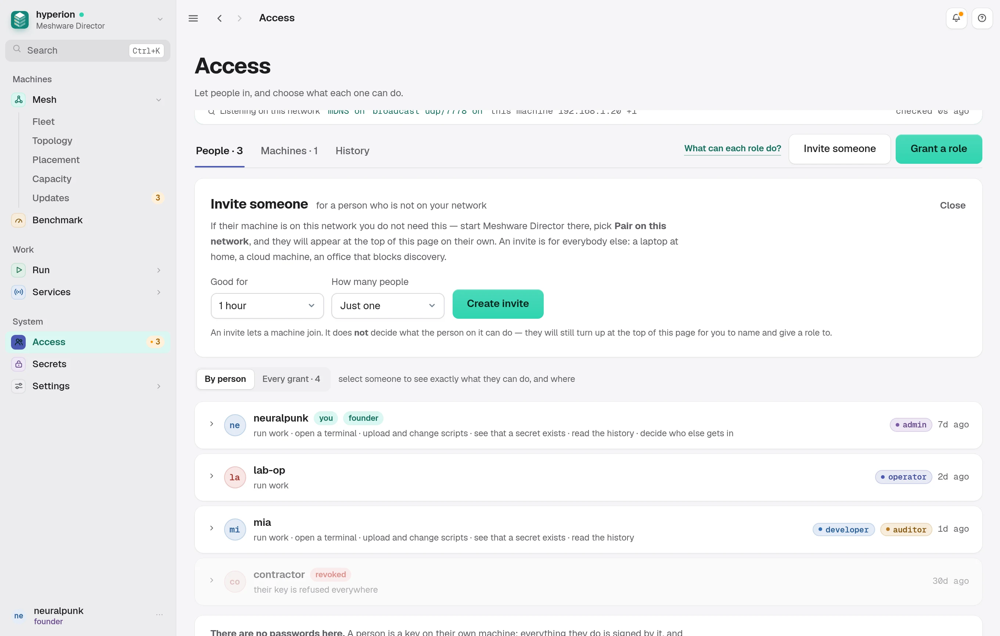

**Machines** lists **service accounts** — keys for scripts and CI pipelines rather than people, each
with an expiry — and the **identity providers** (single sign-on) this mesh trusts.

**History** is the audit log: every governed action, who did it, on what, and how it ended.

[People, machines and roles](operating/identity.md) explains all of this in depth.

### Secrets

Passwords, tokens and keys that jobs need but nobody should see printed. A secret is sealed on this
computer before it leaves it, and opened only by the machine that runs the job that uses it. A job
refers to it as `{{secret:db-pass}}` in its environment.

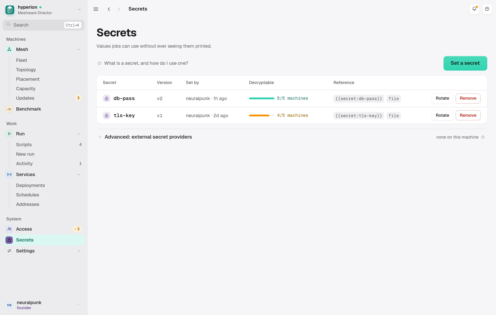

- **Set a secret** — a name and a value (or a file). The value is never written to disk in the
  clear and never logged.
- **Rotate** sets a new value under the same name; **Remove** deletes it.
- **Decryptable** shows how many machines can open each one. Machines that join later get it
  automatically.

No role can read a secret's value through Director.

### Settings

Settings has a pane for each question, listed under it in the sidebar:

| Pane | What it is for |
|---|---|
| **This machine** | Who this computer is in the mesh: its node, your key, its address. Protect your key with a passphrase, or move it onto a security key; choose whether this computer contributes compute; its tags |
| **Director** | This app: start at login (into the tray), watching for machines that want to join, updates, where the log is |
| **Invites** | Create an invite for a machine that is not on this network |
| **Facts** | What every machine is asked to report about itself — OS, kernel, CPU, GPUs |
| **Diagnostics** | **Run doctor**: this machine's health, end to end |
| **Retention & export** | How long the mesh keeps runs, facts, job output and the audit log; exporting a copy to a system you already own |
| **Storage** | What this computer keeps on disk, how long unused content stays, and room left on every machine |
| **Backup & stopping** | Back up this node, see its configuration, stop the whole mesh taking new work (**Shed load**), or **Drain** this machine before maintenance |
| **About & licence** | Which build this is, its licence texts (MIT and Apache 2.0), and where to get help |

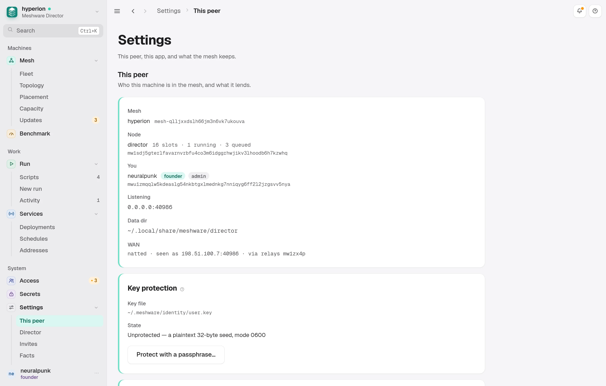

---

## Closing the window

Closing the window hides Director to the system tray, whose icon is a live picture of the mesh —
one dot per machine — with the number of running jobs in its menu. **Quit Meshware** in that menu
stops Director. Neither one takes this computer out of the mesh: its node is its own process, and
stops only when you drain it (*Settings › Backup & stopping*) or stop the service
(`systemctl --user stop meshnode`).

On GNOME, tray icons need the *AppIndicator and KStatusNotifierItem Support* extension
(`sudo dnf install gnome-shell-extension-appindicator` on Fedora, then log out and back in).
Without it, closing the window quits Director. *Settings › Director* says which case you are in.

## Every action, both ways

| In a terminal | In Director |
|---|---|
| `meshnode status`, `meshnode nodes` | Mesh › Fleet |
| `meshnode adopt ops@host-{1..3}` | Mesh › Fleet › Add machines |
| `meshnode pair` | Access — the machine appears at the top; **Let in…** |
| `meshnode invite create` | Access › Invite someone, or Settings › Invites |
| `meshnode nodes tag web-7 --add prod` | Mesh › Fleet → the machine → Tags |
| `meshnode nodes drain web-7` | Mesh › Fleet → the machine → Drain |
| `meshnode nodes contribute web-7 --off` | Mesh › Fleet → the machine → Contributing |
| `meshnode nodes quarantine web-7` | Mesh › Fleet → the machine → Quarantine |
| `meshnode nodes revoke web-7` | Mesh › Fleet → the machine → Revoke |
| `meshnode upgrade --status`, `meshnode upgrade --on tag=canary --to …` | Mesh › Updates (the mesh rollout is under Advanced) |
| `meshnode runtimes`, `meshnode ports`, `meshnode volumes` | Mesh › Capacity |
| `meshnode deployment placement` | Mesh › Placement |
| `meshnode cc gcc -c f.c -o f.o`, `meshnode cache stats` | Run › Scripts › Build farm |
| `meshnode add ./script.sh` | Run › Scripts › Add a script, or drop the file on the window |
| `meshnode run …` | Run › New run |
| `meshnode jobs`, `meshnode jobs logs <job>` | Run › Activity |
| `meshnode history jobs`, `meshnode history results <group>`, `meshnode history diff A B` | Run › Activity › History and Answers |
| `meshnode deployment put web.yaml` | Services › Deployments › New deployment |
| `meshnode deployment status web` | Services › Deployments → open *web* |
| `meshnode deployment scale`, `restart`, `rollout`, `rollback`, `pause` | Services › Deployments → open it → the buttons along the bottom |
| `meshnode schedule put nightly.toml` | Services › Schedules › New schedule |
| `meshnode registry web` | Services › Addresses → open *web* |
| `meshnode users pending`, `meshnode users approve …` | Access — the person appears at the top; **Let in…** |
| `meshnode grants add mia --role operator --nodes tag=staging` | Access › Grant a role |
| `meshnode users rotate mia --new-key …` | Access › People → the person → Replace key… |
| `meshnode serviceaccounts create ci-deploy …` | Access › Machines › Service accounts |
| `meshnode audit` | Access › History |
| `meshnode secrets set db-pass` | Secrets › Set a secret |
| `meshnode identity protect` | Settings › This machine › Key protection |
| `meshnode identity hardware ls`, `status`, `use …` | Settings › This machine › Security key → **Set up a security key**; **Go back to your previous key** undoes it |
| `ssh-add -s <pkcs11 module>` (connect a YubiKey) | Settings › This machine › Security key → **Connect**, with the PIN |
| `meshnode identity hardware attest …`, `unattest` | Settings › This machine › Security key › Proof; an admin withdraws anyone's in Access › People → the person |
| `meshnode users attest-root add …`, `ls`, `rm` | Access › Machines › Security key makers |
| `meshnode upgrade --trust-key …`, `--cosign …` | Mesh › Updates › Advanced › Release keys; a release without its co-signature has **Attach co-signature…** |
| `meshnode doctor` | Settings › Diagnostics |
| `meshnode retention show` | Settings › Retention & export |
| `meshnode shed submissions` | Settings › Backup & stopping › Shed load |
| `meshnode backup` | Settings › Backup & stopping › Back up this node… |
| `meshnode drain` | Settings › Backup & stopping › Drain this machine |
| `meshnode up --detach` | Opening Director: it starts this computer's node when it is not running |
