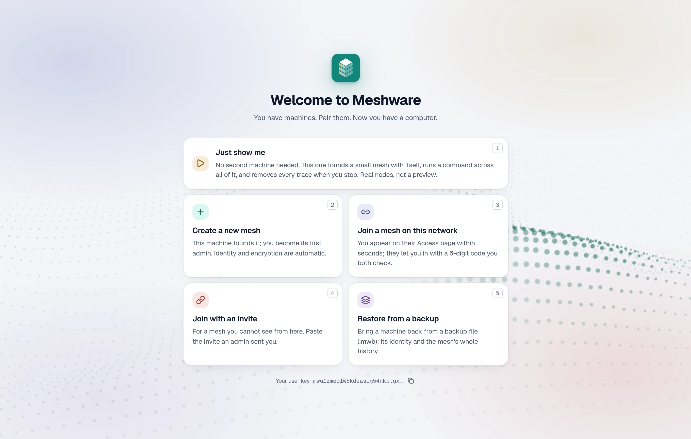

# Quickstart

From nothing to a two-machine mesh running your commands, in about ten minutes. Every step here
was run end to end on a real build before it was written down.

You need:

- **Two or more Linux machines** (x86_64 or aarch64) that can reach each other on **UDP port
  7777**. One machine is enough to try it; see [Try it on one machine](#try-it-on-one-machine).
- A terminal on each, and `sudo` if you want the binary in `/usr/local/bin`.
- Optionally, the [GitHub CLI](https://cli.github.com) (`gh`) to prove where the download came from.

Nothing else: no database, no server to set up first, no certificates, no account to sign up for.

---

## 1. Download

Each release on [GitHub](https://github.com/neuralpunk/meshware/releases) publishes a small set
of files. For the version you are installing, download these into one directory:

| File | What it is |
|---|---|
| `meshnode-v<version>-<arch>-unknown-linux-musl.tar.gz` | The node: the `meshnode` binary, its systemd unit, its man page and the licences |
| `SHA256SUMS` | Checksums for every file in the release |

Prefer to build it yourself? `make` in a clone of the repository does it in a few minutes — see
[installing from source](operating/install.md#from-source--make).

`<arch>` is what `uname -m` prints: `x86_64` or `aarch64`. The binary is static, so the Linux
distribution and its glibc version do not matter.

The rest of this page uses two shell variables so that every command can be pasted as is:

```console
$ V=1.1.0                      # the version you downloaded
$ A=$(uname -m)                 # x86_64 or aarch64
```

## 2. Verify

Check the download before you run anything. The checksum catches a file that was cut short or
corrupted:

```console
$ sha256sum --ignore-missing -c SHA256SUMS
```

The checksum comes from the same place as the file, so it cannot prove *where* the file came
from. GitHub's build-provenance attestation can: it ties the file to the commit and the release
workflow in the Meshware repository that built it, and there is no key anybody has to keep.

```console
$ gh attestation verify meshnode-v$V-$A-unknown-linux-musl.tar.gz --repo neuralpunk/meshware
```

If that fails, the file is not one Meshware's release workflow built. Do not install it.

Meshware has **no project-wide signing key**, on purpose: nobody has to keep one safe for your
mesh to keep working. Once your mesh is running, it installs upgrades only when one of *your*
admins has signed them — see [Upgrading](operating/upgrade.md).

## 3. Install

On **every** machine that will be part of the mesh:

```console
$ tar xzf meshnode-v$V-$A-unknown-linux-musl.tar.gz
$ sudo install -m755 meshnode /usr/local/bin/
$ meshnode --version
```

That is the whole install. There is nothing to configure: each machine works out its own cores,
memory, GPUs and what it can run the first time it starts.

> [!TIP]
> Machines you manage with a package manager can use the `.deb` or `.rpm` from the same release
> instead, and machines you can already SSH to can be set up in one command from the first
> machine with `meshnode adopt` — see step 5. [Installing a node](operating/install.md) covers
> every way in detail.

## 4. Start the first machine

On the first machine, start the node:

```console
$ meshnode up
  Welcome. This machine is founding a new mesh.

    mesh       alpha-mesh
    node       alpha
    listening  0.0.0.0:7777
    …
```

`meshnode up` runs in the foreground, so leave it running and open a second terminal. The first
time it runs it creates this machine's identity and founds a new mesh with **you as its
administrator**. Check it:

```console
$ meshnode status
Meshware Node 1.1.0
  node      mw1xqka4662aop7  (alpha)
  mesh      alpha-mesh  (mesh-t33bwjcpisf7izqu3m7t6xncge)
  members   1 alive / 1 total
  jobs      0 running, 0 queued (16 slots)
  runtimes  exec, bash, python, ansible, container
  …

$ meshnode doctor          # every check this machine can make on itself
```

A one-machine mesh already works: `meshnode run 'uname -a'` runs a command on it.

## 5. Add a second machine

Pick whichever of these fits. In each case, the machine being added needs `meshnode` installed
(step 3) and must be able to reach the first machine on UDP 7777.

### On the same network: pair

On the **new** machine:

```console
$ meshnode pair
```

At the same time, on the **first** machine (in your second terminal):

```console
$ meshnode pair
```

Both screens show the same six digits (and the same two words). If they match, confirm on both.
Then, on the new machine, start its node:

```console
$ meshnode up
```

`pair` works out which side it is on by itself: a machine that is not in a mesh asks to join, and
a machine that is lets it in.

### Anywhere else: an invite

On the first machine, create a single-use invite:

```console
$ meshnode invite create --uses 1
invite inv-yyarmcox7vk7g (1 use(s)). On the new node, run:

meshnode join mwj1t33bwjcpisf7izqu3m7t6xncghdacfqj276vl44nx6t4hu72…
```

On the new machine, paste that command, then start the node:

```console
$ meshnode join mwj1t33bwjcpisf7izqu3m7t6xncghdacfqj276vl44nx6t4hu72…
joined mesh 'alpha-mesh' (accepted by mw1xqka4662aop7) — 2 member(s)
run `meshnode up` to start participating.

$ meshnode up
```

**An invite token is a password for as long as it is valid.** Keep `--uses 1` for one machine, and
send it the way you would send a password. `meshnode invite revoke` cancels one that went
somewhere it should not have.

### Several machines you can already SSH to: adopt

From the first machine, this installs `meshnode` on each host, sets it up as a service, pairs it
(showing you each confirmation code) and starts it:

```console
$ meshnode adopt ops@rack-{1..3}
```

It uses SSH once, to install. After that, everything goes through the mesh. SSH to each host by
hand once first, so its host key is known.

### Check

```console
$ meshnode nodes
ST  NODE             NAME          ADDRESS            CAPACITY            TAGS  JOINED
●   mw1xqka4662aop7  alpha (self)  192.168.1.20:7777  16c/61G/30G x86_64  -     2m ago
●   mw1onj6yndtp6pi  beta          192.168.1.31:7777  16c/61G/30G x86_64  -     11s ago
```

## 6. Run something

From the **first** machine:

```console
$ meshnode run 'uname -sr' --on any          # on whichever machine has room
▸ uname -sr  on beta · job-agqljao2xx

Linux 6.11.0-200.fc44.x86_64

✓ succeeded · beta · 41ms

$ meshnode run 'hostname' --fanout all       # on every machine at once
▸ hostname  on 2 machines · fan-agqljao25j

 alpha  ✓ succeeded · 38ms
 │ alpha

 beta   ✓ succeeded · 52ms
 │ beta

✓ alpha     38ms  succeeded
✓ beta      52ms  succeeded

✓ Both machines succeeded · 52ms
```

The exit code of `meshnode run` is the exit code of the command. On one machine, output streams
back live. On several, each machine's output is printed as one block when that machine finishes,
and while they run, a board at the bottom of the terminal shows each one's latest line. Add
`--stream` to see every line the moment it arrives instead. Sent to a pipe or a file, the output
is one line per line of output, marked with the machine: `[alpha] alpha`.

> [!IMPORTANT]
> **Commands work from the first machine because you founded the mesh there.** A person is a key,
> and on every other machine your key is a different one that the mesh has not met yet. To run
> commands from the second machine, ask the mesh to recognise you there:
>
> ```console
> # on the second machine:
> $ meshnode enrol --as sam
> Enrolment code: DIZZY-RAVEN-2636
> Show this code to a mesh admin. Waiting for approval…
>
> # on the first machine:
> $ meshnode users approve DIZZY-RAVEN-2636 --role operator
> ```
>
> [People, machines and roles](operating/identity.md) explains roles and how to let other people in.

## 7. Add Director

Director is the desktop app: the whole mesh live on one screen, and everything the command line
does, with buttons. It is a view onto **this computer's node** — the same `meshnode` every other
machine runs — and it starts that node the first time it needs one, so there is nothing to set up
first.

1. Start Director on your desktop. [Getting Director](director.md#getting-director) says how to get it.
2. On the welcome screen, choose **Join with an invite**, and paste a token from
   `meshnode invite create` on the first machine. (On the same network, **Join a mesh on this
   network** works too, and a member lets you in with `meshnode pair`.)
3. Enter the name people will know you by. Director asks the mesh to recognise you, and an admin
   approves you, either from **Access** in their own Director or with `meshnode users approve`.



On a machine that already runs `meshnode`, Director joins alongside it as a user rather than
adding the same machine to the mesh twice.

## Try it on one machine

No second machine, or not ready to install anything yet:

```console
$ meshnode demo
```

This starts three real nodes on `127.0.0.1`, joins them together, runs a command across all of
them, and removes every trace when you press Ctrl-C. It does not touch `~/.meshware` and cannot
join a real mesh. Director's welcome screen offers the same thing as **Just show me**.

## Where to go next

| To… | Read |
|---|---|
| Keep the node running after you log out, as a system service | [Installing a node](operating/install.md) |
| Let other people in, and choose what each of them can do | [People and access](guides/people-and-access.md) |
| Run commands across machines, and add more machines | [Running work](guides/running-work.md), [Machines](guides/machines.md) |
| Give jobs passwords and tokens safely | [Secrets](guides/secrets.md) |
| Keep a service running across machines | [Deployments](deployments.md) |
| Find your way around the app | [The Director guide](director.md) |
| Know which ports to open | [Network](operating/network.md) |
| Fix something that did not work | [Troubleshooting](operating/troubleshooting.md) |
